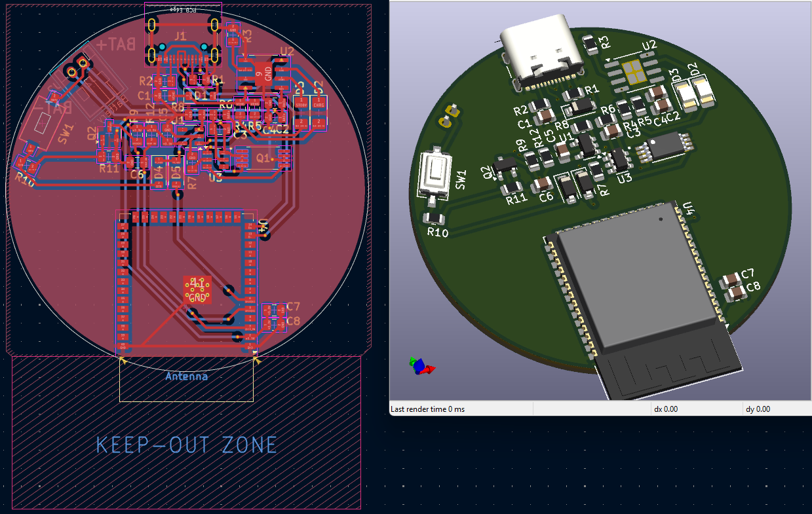
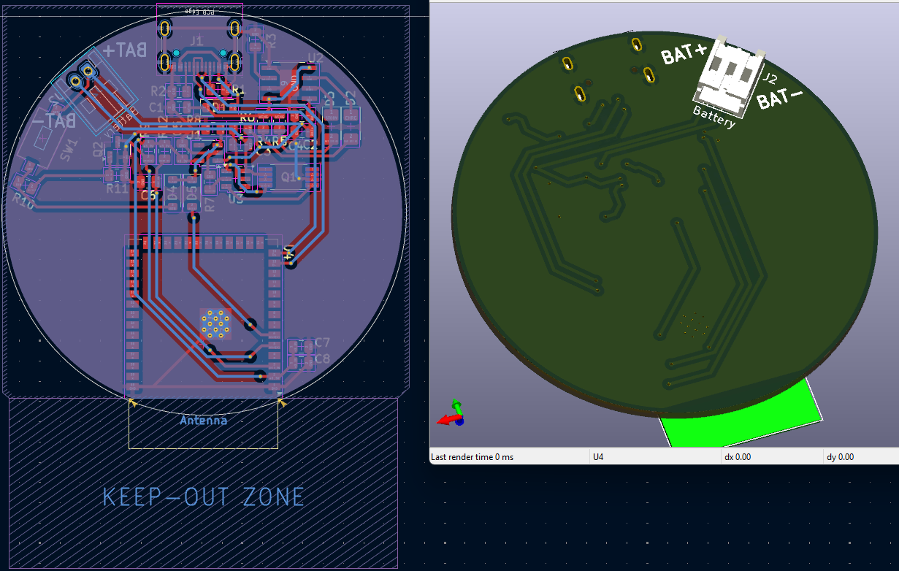
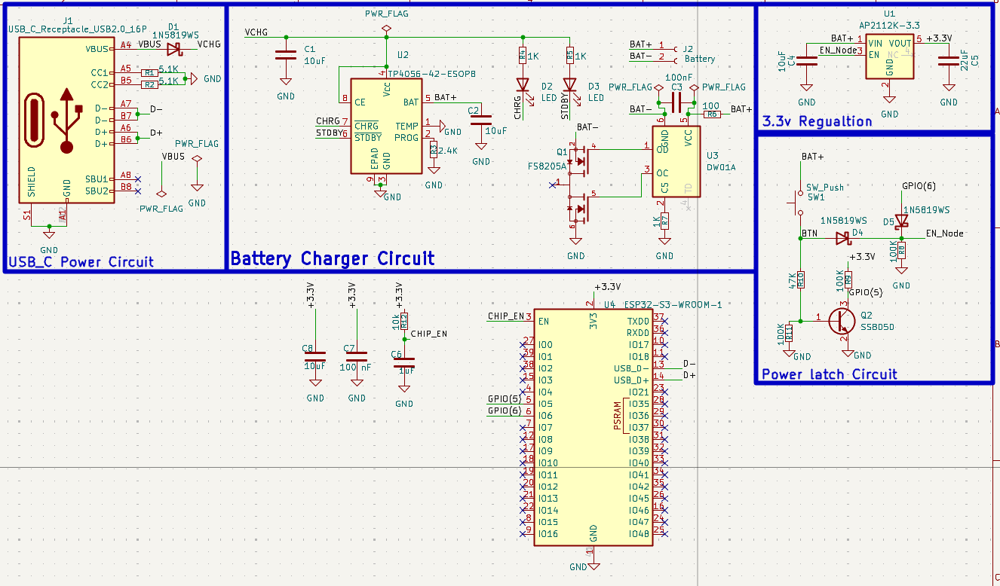

# Smartwatch PCB — ESP32-S3

A work-in-progress smartwatch PCB designed in KiCad around an ESP32-S3-WROOM-1 module. The current schematic includes USB-C power input, Li-ion battery charging and protection, 3.3 V regulation, a push-button/power-latch circuit, and the ESP32-S3 module.

> **Status: Work in progress.** The NTC temperature sensor and MAX30102 breakout module have not yet been added to the schematic/PCB. This revision is not a completed smartwatch design and has not been represented as fabricated or functionally tested.

## Current Design Highlights

- **MCU:** ESP32-S3-WROOM-1
- **USB-C input:** USB 2.0 receptacle used for power input in the current schematic; CC pull-down resistors are shown.
- **Battery charging:** TP4056-based single-cell Li-ion charging circuit.
- **Battery protection:** DW01A with FS8205A dual MOSFET.
- **3.3 V rail:** AP2112K-3.3 regulator.
- **Power control:** Push button and discrete power-latch circuitry.
- **PCB form factor:** Circular board with a marked antenna keep-out region.

The list above describes what is visible in the current KiCad source files. Confirm component ratings, power-path behavior, charging current, thermal limits, antenna clearances, and battery safety before fabrication.

## Planned Additions

- [ ] Add an NTC temperature-sensing circuit and connector/footprint as required.
- [ ] Integrate a ready-made MAX30102 breakout module for heart-rate and SpO₂ sensing, including power, GND, SDA, and SCL connections; verify the module's supply voltage and logic-level compatibility.
- [ ] Check ESP32-S3 GPIO assignments and I²C pull-up strategy.
- [ ] Re-route the PCB after the new components are placed.
- [ ] Run ERC and DRC on the revised design.
- [ ] Review the antenna keep-out and RF layout against the module manufacturer's guidance.
- [ ] Generate and inspect final Gerber/drill outputs after design freeze.
- [ ] Fabricate and test the board before claiming functional validation.

## Design Images

### Current PCB — front / component side



### Current PCB — back side



### Current schematic



## Repository Structure

```text
.
├── KiCad/
│   ├── SmartWatch.kicad_pro
│   ├── SmartWatch.kicad_sch
│   └── SmartWatch.kicad_pcb
├── Images/
│   ├── smartwatch-pcb-front-3d-layout.png
│   ├── smartwatch-pcb-back-3d-layout.png
│   └── smartwatch-schematic-current-revision.png
├── Documentation/
└── README.md
```

## Opening the Project

1. Download or clone this repository.
2. Open `KiCad/SmartWatch.kicad_pro` in KiCad 9.
3. Review the schematic and PCB together.
4. Complete the planned additions before generating manufacturing files.
5. Run ERC and DRC after each substantial revision.

## Validation Status

- [x] Current KiCad project files included
- [x] Current design screenshots included
- [ ] NTC added
- [ ] MAX30102 added
- [ ] ERC/DRC reviewed on the final revision
- [ ] Final Gerbers generated and inspected
- [ ] PCB fabricated
- [ ] Hardware assembled and functionally tested

## License

No open-source license is included in this work-in-progress package yet. Choose and add a license before publishing the design for reuse.
